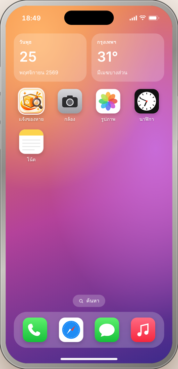
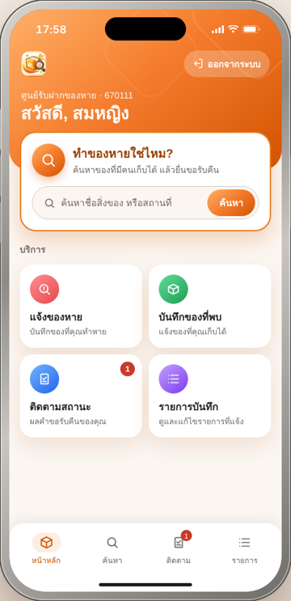
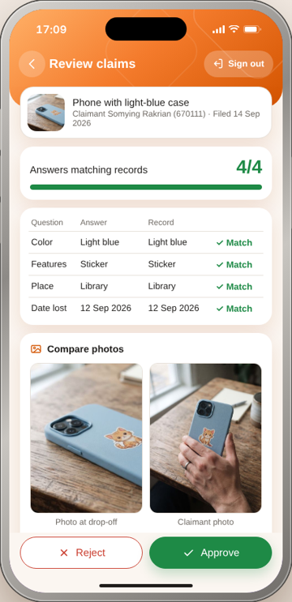

# ระบบศูนย์กลางรับฝากและติดตามของหาย (Lost & Found)

ต้นแบบแอปพลิเคชัน (Prototype) สำหรับรายวิชา CS3863 วิศวกรรมซอฟต์แวร์ มหาวิทยาลัยหัวเฉียวเฉลิมพระเกียรติ

A clickable prototype of a university lost-and-found center, shown inside an iPhone frame. Thai / English.

## เปิดใช้งาน

เปิดไฟล์ `index.html` ด้วยเบราว์เซอร์ หรือเปิดผ่าน GitHub Pages
แตะไอคอน **แจ้งของหาย** บนหน้าจอ iPhone เพื่อเข้าแอป และแตะแถบด้านล่างจอเพื่อกลับหน้าแรก

| บทบาท | รหัส | รหัสผ่าน |
|---|---|---|
| นักศึกษา | 670111, 670222, 670333 | 1234 |
| เจ้าหน้าที่ | staff01, staff02 | 1234 |

## ฟังก์ชันหลัก (7 Use Case)

1. เข้าสู่ระบบ
2. แจ้งของหาย / บันทึกของที่พบ / แก้ไขรายการ
3. ค้นหารายการ
4. ยื่นคำขอรับคืน พร้อมแนบรูปยืนยันได้สูงสุด 3 รูป
5. ตรวจสอบและอนุมัติคำขอ (เทียบคำตอบและรูปภาพ)
6. ออกรายงานรายเดือน ส่งออก Excel (.csv) และ PDF
7. จัดการระบบ (บัญชี สิทธิ์ สถานที่ หมวดหมู่)

ข้อมูลทั้งหมดเป็นข้อมูลตัวอย่าง เก็บไว้ในเบราว์เซอร์ (localStorage)

## ภาพหน้าจอ

<p>




</p>

## โครงสร้างไฟล์

```
index.html          โครงหน้า (กรอบ iPhone)
css/style.css       หน้าตาทั้งหมด
js/core.js          ฟังก์ชันช่วย วันที่ และค่าคงที่
js/i18n.js          ภาษาไทย / อังกฤษ
js/data.js          ไอคอน รูปตัวอย่าง และข้อมูลตัวอย่าง
js/screens.js       หน้าจอของแอป (S01–S19)
js/calendar.js      ปฏิทินเลือกวันที่
js/dialogs.js       กล่องข้อความ ส่งออกรายงาน (Excel / PDF) และรูปภาพ
js/app.js           การแสดงผล ปุ่ม และการทำงานของแต่ละเมนู
js/iphone.js        หน้าจอ iPhone แถบสถานะ และการเปิด/ปิดแอป
images/             รูปสิ่งของ โลโก้ และภาพหน้าเข้าสู่ระบบ
screenshots/        ภาพหน้าจอสำหรับ README
```

## เทคโนโลยี

HTML, CSS และ JavaScript ไม่ต้องติดตั้งอะไรเพิ่ม ไฟล์ JavaScript โหลดตามลำดับใน `index.html`
